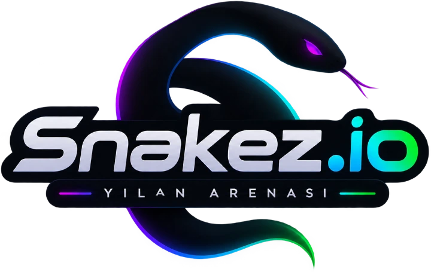
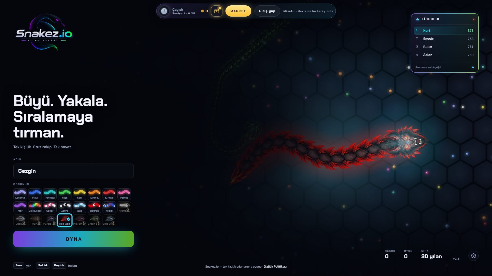
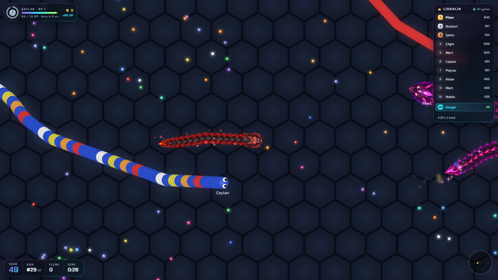
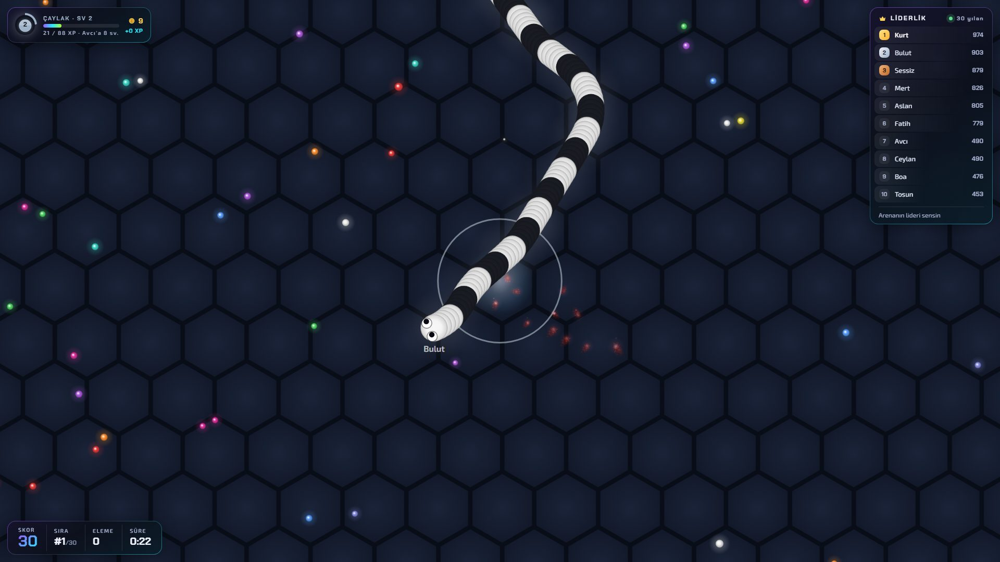
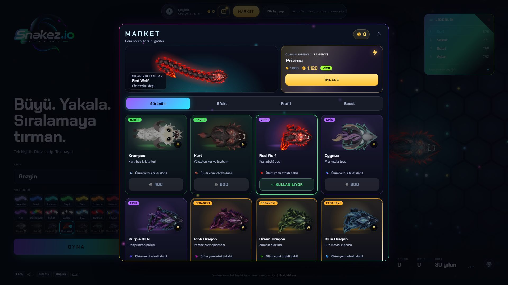
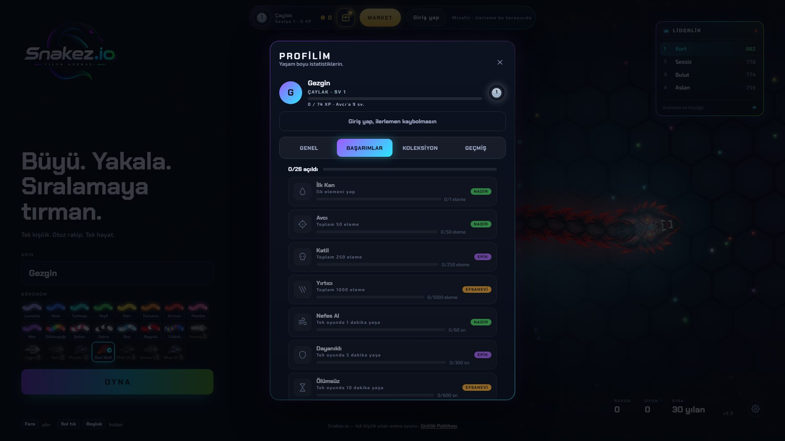
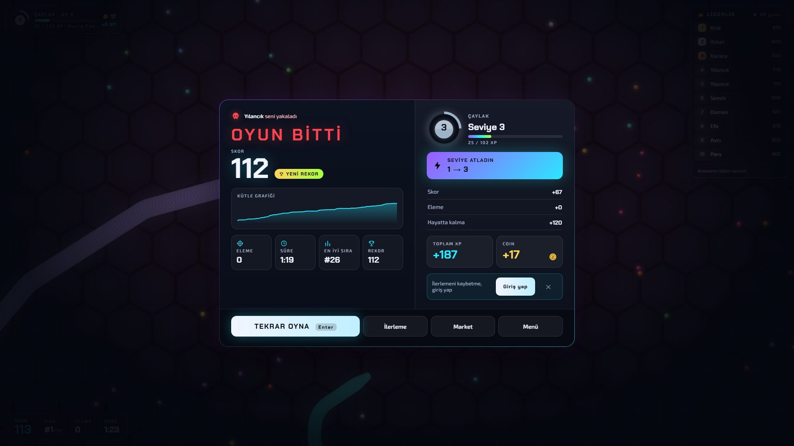
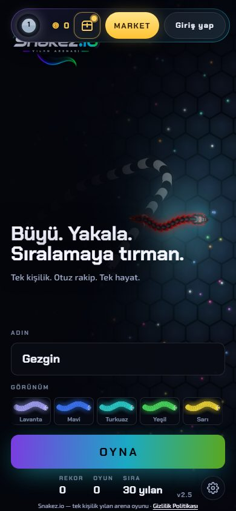
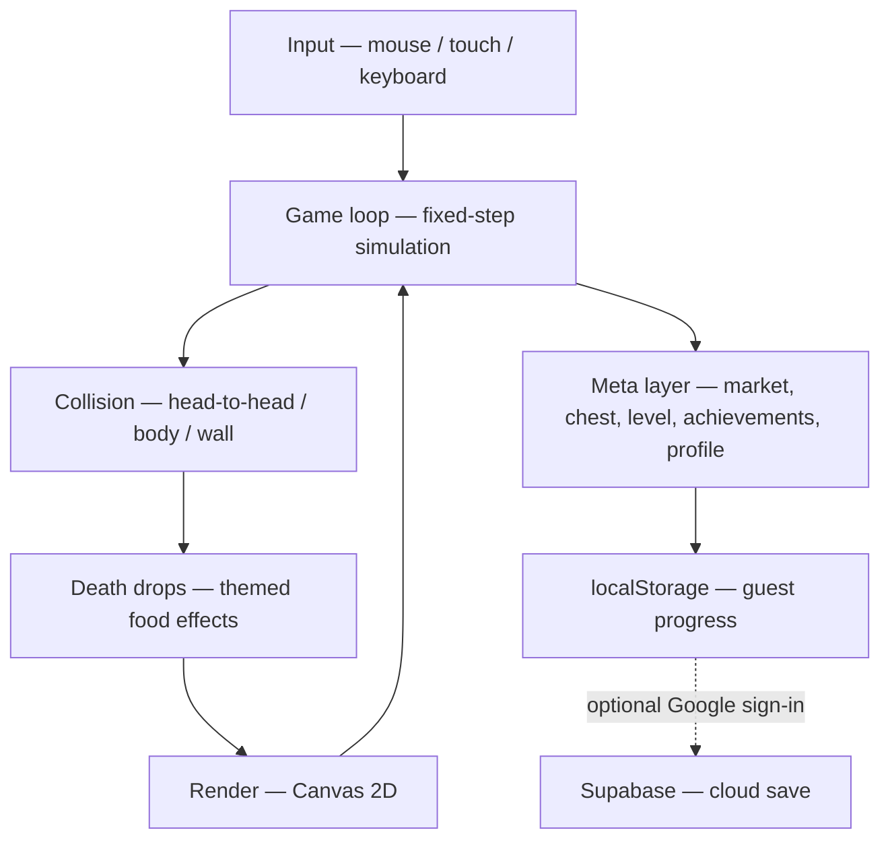

🌐 **English** · [Türkçe](README.tr.md)

<div align="center">
  

  <h1>Snakez.io</h1>

  <p><b>A browser snake arena where you grow, outmaneuver 30 bot rivals, and climb the board — no install, no account needed.</b></p>

  <p><a href="https://snakez-io.vercel.app"><b>▶ Play now — snakez-io.vercel.app</b></a></p>

  <p>
    
    
    
    
  </p>
</div>

## Screenshots

<table>
  <tr>
    <td></td>
    <td></td>
  </tr>
  <tr>
    <td></td>
    <td></td>
  </tr>
  <tr>
    <td></td>
    <td></td>
  </tr>
  <tr>
    <td colspan="2" align="center"></td>
  </tr>
</table>

## Features

- **Play in seconds** — open the page, type a name, hit PLAY. Guests keep their progress in the browser; no sign-up required.
- **30 bot rivals per round** — a single-player arena with a live in-round leaderboard plus score, rank, elimination and survival-time HUD.
- **Grow, boost, collide** — collect food to gain mass; hold the left mouse button (or space bar, or the mobile BOOST button) to speed up. Head-to-head, body and wall collisions decide who drops their mass as food on the floor.
- **Themed death-food effects** — premium-skinned snakes leave animated, themed pellets (8 premium skins → 8 themes) with glow and sparks where they die.
- **Market** — spend coins on skins, name styles, profile frames and effects.
- **Free daily chest & daily deal** — one free chest every day, and one market item goes on sale each day.
- **Levels, ranks and 28 achievements** — earn XP for score, eliminations and survival time; advance through ranks and unlock achievements with visible progress.
- **Profile & history** — career stats, best score, total eliminations, playtime; the death screen adds the run summary with a mass graph and level progress.
- **Optional cloud save** — sign in with Google (Supabase) to sync progress across devices; with no configuration the game runs entirely in guest mode.
- **Mobile ready** — touch steering and a dedicated BOOST button, with a responsive menu.
- **Turkish UI** — the game interface is currently Turkish only.
- **Privacy page** — bundled `gizlilik.html` privacy policy.

## How it works

Snakez.io is a vanilla TypeScript + Canvas 2D application — no framework and no server-side simulation. A single canvas renders the arena; a fixed-step game loop advances movement and collisions; the meta layer (market, chest, level, achievements, profile) is plain DOM on top. Supabase is used only for optional Google sign-in and cloud save; without it, everything runs locally.



## Tech

| Layer | Choice |
| --- | --- |
| Language | TypeScript 6 — no framework, plain CSS |
| Build & dev server | Vite 8 |
| Rendering | Canvas 2D |
| Fonts | Self-hosted Chakra Petch and Exo 2 via @fontsource (no CDN) |
| Back end (optional) | Supabase — Google sign-in + cloud save |
| Tests | Playwright (Chromium) |

## Project structure

```
src/
├─ core/       game loop, camera, main Game class
├─ entities/   Snake, Bot, Food, Skin
├─ systems/    movement, collision, rendering, death effects, sprite skins
├─ menu/       main menu, logo showcase, run log, local storage
├─ meta/       market, daily chest, career, achievements, profile views
├─ auth/       Supabase client, session handling, cloud save
├─ privacy/    privacy policy page (gizlilik.html entry)
├─ assets/     sprite-skin artwork (webp)
└─ utils/      constants, settings, FPS meter, math helpers
public/        static files (favicon, logo, death-food sprites, og.png)
scripts/       Playwright verification and asset tooling
docs/          screenshots and social preview image
```

The build is multi-page (`index.html` + `gizlilik.html`); no source maps are emitted and every JS chunk begins with a copyright banner (see `vite.config.ts`).

## Run locally

Requirements: **Node.js 22+** and npm 10+. For the Playwright suites, install Chromium once with `npx playwright install chromium`.

```bash
npm ci
npm run dev      # http://localhost:5173
```

### Environment variables (optional)

Copy `.env.example` to `.env.local` if you want sign-in and cloud save:

| Variable | Purpose |
| --- | --- |
| `VITE_SUPABASE_URL` | Supabase project URL |
| `VITE_SUPABASE_ANON_KEY` | Supabase anon (public) key |

- Leave both empty and the game runs fully in **guest mode** — sign-in and cloud save stay off, everything else works.
- The anon key is public by design (it ships in the client); protection comes from Row Level Security on the Supabase side. Never put the `service_role` key in `.env` files or the repo.
- `.env*` files are gitignored; only `.env.example` is tracked.

## Tests

> Start the dev server on port 5173 first. In-game test hooks (`render_game_to_text`, `advanceTime`, `__menu`, `__poll`) are dev-only and never ship in production builds.

```bash
npm run verify        # core scenarios (desktop + mobile)
npm run verify:ui     # same, headed window
```

| Script | Coverage |
| --- | --- |
| `verify:menu` | Menu flows (name, persistence, buttons) |
| `verify:brand` | Logo and top-bar sanity (unchanged on hover/touch/reduced motion) |
| `verify:contrast` | Color contrast |
| `verify:view` | Camera zoom formula independent of viewport size |
| `verify:food` | Food economy (map size, floor stock density, respawn fill) |
| `verify:clash` | Head-to-head collisions (exactly one side dies) |
| `verify:deathfx` | Death-food effects (skin→theme, value conservation, FPS, low quality) |
| `verify:deathfood` | Death-food sprite pipeline (network load proof; falls back to plain food) |
| `verify:runlog` | Run-log regression (tab hide/show keeps the run; retry/menu counted once) |
| `verify:seo` | Search Console meta, title/description, og/twitter tags, footer and README image links (source + `dist/` after build) |

## Deployment (Vercel)

1. Import the repo on Vercel — Framework Preset: **Vite**, Build: `npm run build`, Output: `dist`.
2. **Environment Variables:** `VITE_SUPABASE_URL` and `VITE_SUPABASE_ANON_KEY` (Production + Preview).
3. In Supabase → **Authentication → URL Configuration**, set the deploy address (Site URL and Redirect URL), e.g. `https://snakez-io.vercel.app` — otherwise Google sign-in cannot return.
4. `vercel.json` adds a CSP and `X-Content-Type-Options: nosniff` headers to every response.

> Even without environment variables the site loads; only sign-in and cloud save stay disabled.

## Privacy

The game includes a privacy policy page (Turkish): [snakez-io.vercel.app/gizlilik.html](https://snakez-io.vercel.app/gizlilik.html).

## License

**Snakez.io Proprietary License** — © 2026 JAYNUS — all rights reserved. GitHub: [@JaynusHUB](https://github.com/JaynusHUB)

The source code and artwork in this repository are publicly **viewable**, but viewing is not a license. Without the owner's prior written permission you may not:

- copy, reproduce or redistribute the software or any part of it;
- modify, adapt, translate or create derivative works;
- sell, sublicense, rent or otherwise commercialize it;
- use it, in whole or in part, for any commercial purpose;
- remove or alter the license or copyright notices.

Playing the game on the official website is permitted. Third-party open-source libraries and fonts remain under their own licenses. The software is provided “as is”, without warranty of any kind. See [LICENSE](LICENSE) for the full text.
