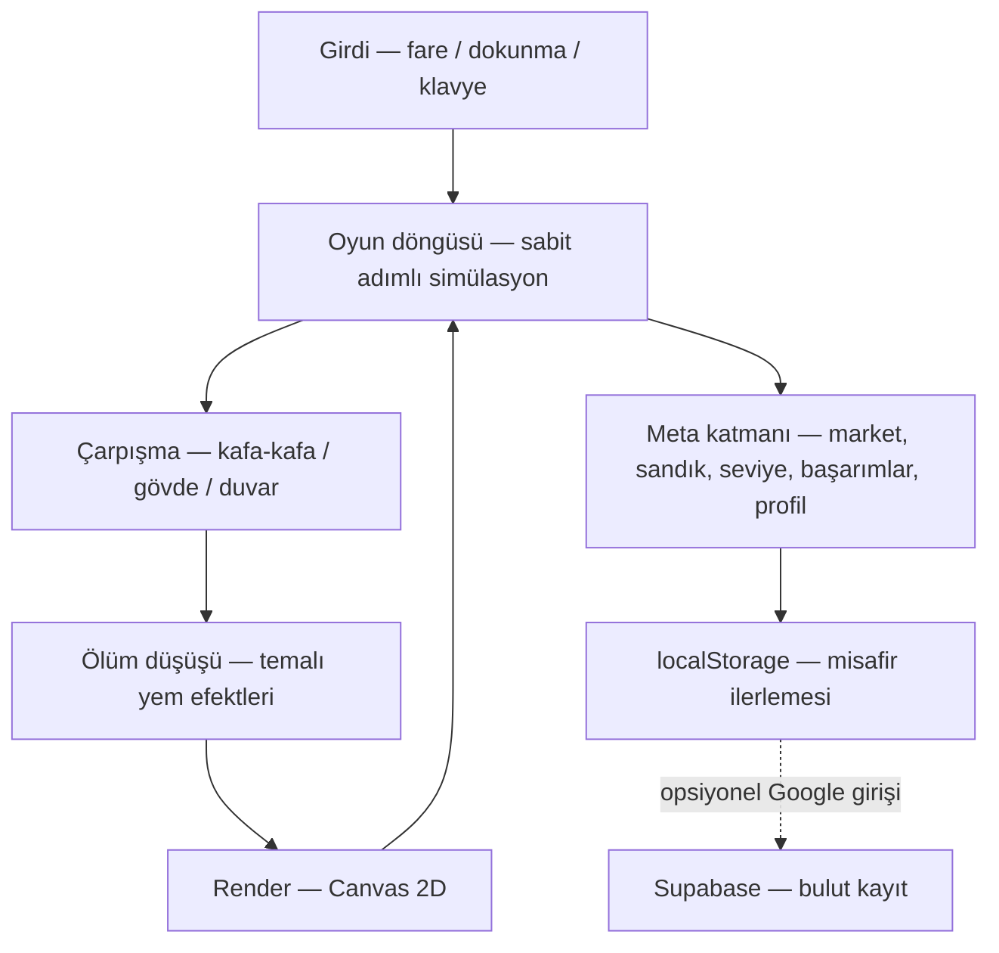

🌐 [English](README.md) · **Türkçe**

<div align="center">
  

  <h1>Snakez.io</h1>

  <p><b>Tarayıcıda çalışan yılan arenası: büyü, 30 bot rakibi alt et ve sıralamaya tırman — kurulum yok, hesap gerekmez.</b></p>

  <p><a href="https://snakez-io.vercel.app"><b>▶ Hemen oyna — snakez-io.vercel.app</b></a></p>

  <p>
    
    
    
    
  </p>
</div>

## Ekran Görüntüleri

<table>
  <tr>
    <td></td>
    <td></td>
  </tr>
  <tr>
    <td></td>
    <td></td>
  </tr>
  <tr>
    <td></td>
    <td></td>
  </tr>
  <tr>
    <td colspan="2" align="center"></td>
  </tr>
</table>

## Özellikler

- **Saniyeler içinde oyna** — sayfayı aç, ismini yaz, OYNA'ya bas. Misafirler ilerlemesini tarayıcıda tutar; kayıt gerekmez.
- **Tur başına 30 bot rakip** — canlı tur içi liderlik tablosu; skor, sıra, eleme ve hayatta kalma süresi HUD'u.
- **Büyü, hızlan, çarpış** — yem toplayıp kütle kazan; sol fare tuşunu (veya boşluk tuşunu / mobilde HIZLAN düğmesini) basılı tutarak hızlan. Kafa-kafa, gövde ve duvar çarpışmaları kütlenin yere yem olarak düşmesine karar verir.
- **Temalı ölüm yemi efektleri** — premium skine sahip yılanlar öldükleri yerde animasyonlu, temalı yemler bırakır (8 premium skin → 8 tema); parıltı ve kıvılcımlarla.
- **Market** — coinlerle skin, isim stili, profil çerçevesi ve efekt al.
- **Günün sandığı ve günün fırsatı** — her gün bir ücretsiz sandık; markette her gün bir ürün indirime girer.
- **Seviyeler, rütbeler ve 28 başarım** — skor, eleme ve hayatta kalma süresinden XP kazan; rütbelerde ilerle ve ilerlemesi görünen başarımların kilidini aç.
- **Profil ve geçmiş** — kariyer istatistikleri, en iyi skor, toplam elemeler, oyun süresi; ölüm ekranı kütle grafiği ve seviye ilerlemesiyle tur özetini ekler.
- **Opsiyonel bulut kayıt** — Google ile giriş yap (Supabase) ve ilerlemeni cihazlar arasında eşitle; yapılandırma yoksa oyun tamamen misafir modda çalışır.
- **Mobil uyumlu** — dokunmatik yönlendirme ve ayrı HIZLAN düğmesi; uyarlanabilir menü.
- **Türkçe arayüz** — oyun arayüzü şimdilik yalnızca Türkçe.
- **Gizlilik sayfası** — depoda `gizlilik.html` gizlilik politikası bulunur.

## Nasıl çalışır

Snakez.io sade TypeScript + Canvas 2D uygulamasıdır — framework yok, sunucu tarafı simülasyon yok. Arenayı tek bir canvas çizer; sabit adımlı oyun döngüsü hareket ve çarpışmaları ilerletir; meta katmanı (market, sandık, seviye, başarımlar, profil) üstte düz DOM'dur. Supabase yalnızca opsiyonel Google girişi ve bulut kayıt için kullanılır; yapılandırılmasa bile her şey yerelde çalışır.



## Teknolojiler

| Katman | Teknoloji |
| --- | --- |
| Dil | TypeScript 6 — framework yok, sade CSS |
| Build & dev sunucu | Vite 8 |
| Render | Canvas 2D |
| Fontlar | @fontsource ile self-host Chakra Petch ve Exo 2 (CDN yok) |
| Arka uç (opsiyonel) | Supabase — Google girişi + bulut kayıt |
| Testler | Playwright (Chromium) |

## Proje yapısı

```
src/
├─ core/       oyun döngüsü, kamera, ana oyun sınıfı (Game)
├─ entities/   Snake, Bot, Food, Skin
├─ systems/    hareket, çarpışma, render, ölüm efektleri, sprite derileri
├─ menu/       ana menü, logo vitrini, tur günlüğü, yerel depolama
├─ meta/       market, günün sandığı, kariyer, başarımlar, profil görünümleri
├─ auth/       Supabase istemcisi, oturum yönetimi, bulut kayıt
├─ privacy/    gizlilik politikası sayfası (gizlilik.html girişi)
├─ assets/     sprite skin görselleri (webp)
└─ utils/      sabitler, ayarlar, FPS ölçümü, matematik yardımcıları
public/        statik dosyalar (favicon, logo, ölüm yemi sprite'ları, og.png)
scripts/       Playwright doğrulama ve varlık üretim scriptleri
docs/          ekran görüntüleri ve sosyal önizleme görseli
```

Derleme çok sayfalıdır (`index.html` + `gizlilik.html`); kaynak haritası üretilmez ve her JS parçasının başına telif banner'ı eklenir (bkz. `vite.config.ts`).

## Yerelde çalıştırma

Gereksinimler: **Node.js 22+** ve npm 10+. Playwright testleri için Chromium'u bir kez kurun: `npx playwright install chromium`.

```bash
npm ci
npm run dev      # http://localhost:5173
```

### Ortam değişkenleri (opsiyonel)

Giriş ve bulut kayıt istiyorsanız `.env.example` dosyasını `.env.local` olarak kopyalayın:

| Değişken | Amaç |
| --- | --- |
| `VITE_SUPABASE_URL` | Supabase proje URL'i |
| `VITE_SUPABASE_ANON_KEY` | Supabase anon (public) anahtarı |

- Değerleri boş bırakırsanız oyun tamamen **misafir modda** çalışır — giriş ve bulut kayıt kapalı kalır, geri kalan her şey eksiksiz çalışır.
- Anon anahtar tasarım gereği herkese açıktır (istemciye gömülür); koruma Supabase tarafındaki Row Level Security ile sağlanır. `service_role` anahtarını asla `.env` dosyalarına ya da repoya koymayın.
- `.env*` dosyaları `.gitignore`'dadır; yalnızca `.env.example` takip edilir.

## Testler

> Önce 5173 portunda dev sunucusunu açın. Oyun içi test kancaları (`render_game_to_text`, `advanceTime`, `__menu`, `__poll`) yalnızca geliştirme modunda tanımlıdır; üretim derlemesinde yer almaz.

```bash
npm run verify        # çekirdek senaryolar (masaüstü + mobil)
npm run verify:ui     # aynısı, görünür pencerede
```

| Script | Kapsam |
| --- | --- |
| `verify:menu` | Menü akışları (isim, kalıcılık, butonlar) |
| `verify:brand` | Logo ve üst bandın sade denetimi (hover/dokunma/hareket azaltmada değişmemeli) |
| `verify:contrast` | Renk kontrastı |
| `verify:view` | Kamera zoom formülünün ekran boyutundan bağımsızlığı |
| `verify:food` | Yem ekonomisi (harita büyüklüğü, zemin stoğu yoğunluğu, doğuş doldurma) |
| `verify:clash` | Kafa-kafa çarpışması (her koşulda taraflardan tam biri ölür) |
| `verify:deathfx` | Ölüm yemi efektleri (skin→tema, değer korunumu, FPS, düşük kalite) |
| `verify:deathfood` | Ölüm yemi sprite hattı (ağ üzerinden yükleme kanıtı; yüklenemezse düz yem) |
| `verify:runlog` | Tur günlüğü regresyonu (sekme gizle/göster turu sıfırlamamalı; TEKRAR/MENÜ tek saymalı) |
| `verify:seo` | Search Console etiketi, başlık/açıklama, og/twitter etiketleri, alt bilgi ve README görsel bağlantıları (kaynak + build sonrası `dist/`) |

## Dağıtım (Vercel)

1. Repoyu Vercel'e import edin — Framework Preset: **Vite**, Build: `npm run build`, Output: `dist`.
2. **Environment Variables:** `VITE_SUPABASE_URL` ve `VITE_SUPABASE_ANON_KEY` (Production + Preview).
3. Supabase → **Authentication → URL Configuration** bölümünde dağıtım adresini (Site URL ve Redirect URL) tanımlayın, örn. `https://snakez-io.vercel.app` — aksi hâlde Google girişi geri dönmez.
4. `vercel.json`, tüm yanıtlara CSP ve `X-Content-Type-Options: nosniff` başlıklarını ekler.

> Ortam değişkenleri eklenmese bile site açılır; yalnızca giriş ve bulut kayıt kapalı kalır.

## Gizlilik

Oyunda bir gizlilik politikası sayfası bulunur (Türkçe): [snakez-io.vercel.app/gizlilik.html](https://snakez-io.vercel.app/gizlilik.html).

## Lisans

**Snakez.io Özel Lisansı** — © 2026 JAYNUS — tüm hakları saklıdır. GitHub: [@JaynusHUB](https://github.com/JaynusHUB)

Bu depodaki kaynak kodu ve görseller herkese açık olarak **görüntülenebilir**; ancak görüntülemek bir kullanım izni değildir. Sahibin yazılı izni olmadan:

- kopyalayamaz, çoğaltamaz, yeniden dağıtamazsınız;
- değiştiremez, uyarlayamaz, türev eser üretemezsiniz;
- satamaz, alt lisanslayamaz, kiraya veremezsiniz;
- ticari amaçla kullanamazsınız;
- telif bildirimlerini kaldıramaz veya değiştiremezsiniz.

Oyunu sahibin sunduğu resmî site üzerinden **oynamak serbesttir.** Üçüncü taraf açık kaynak kütüphaneler ve fontlar kendi lisanslarına tabidir. Yazılım “olduğu gibi” sunulur; hiçbir garanti verilmez. Tam metin için [LICENSE](LICENSE) dosyasına bakın.
